## Operaciones basicas OpenCV
## Alumno Iram Jimenez NC = 0079
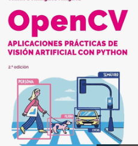
## 1. LECTURA DE LA IMAGEN DESDE LA CARPETA LOCAL
#### Cuando no puede cargar la imagen
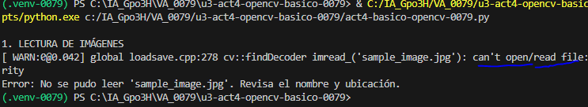
#### Cuando se puede leer la imagen
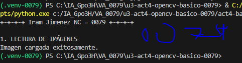
## 2. PROPIEDADES DE LA IMAGEN
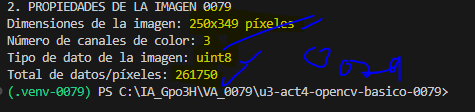
## 3. VISUALIZACIÓN DE LA IMAGEN ORIGINAL
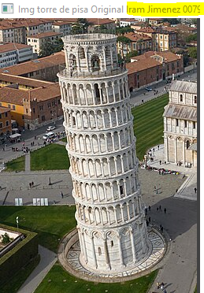
### En la terminal 
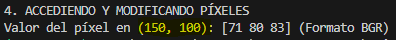
## 4. ACCESO Y MODIFICACIÓN DE PÍXELES INDIVIDUALES
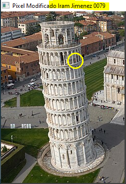
## 5. REGIÓN DE INTERÉS (ROI - REGION OF INTEREST)
#### Imagen con recuadro
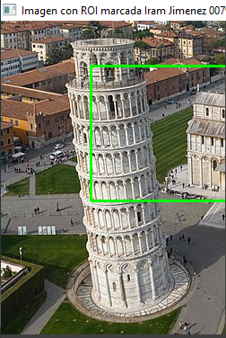
#### Imagen recortada 
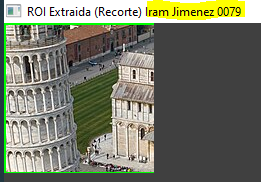
## 6. SEPARACIÓN Y FUSIÓN DE CANALES DE COLOR (BGR)
#### Escala de grises
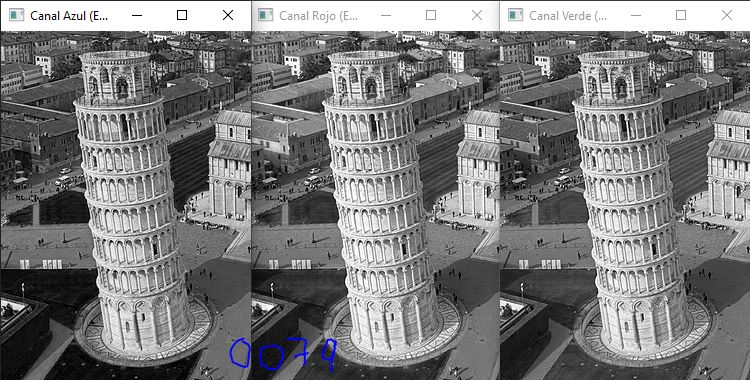
#### A color
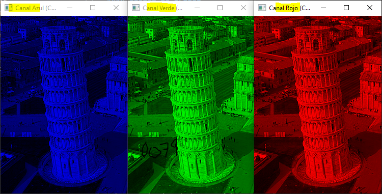
## 7. REDIMENSIONAMIENTO DE IMÁGENES (RESIZING)
#### Redimensionada a 400x300
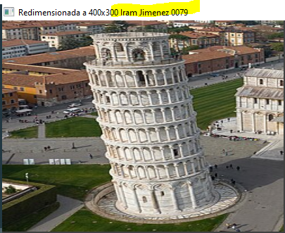
#### Mitad de tamano (0.5x)
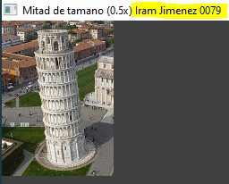
#### Ampliada (1.5x)
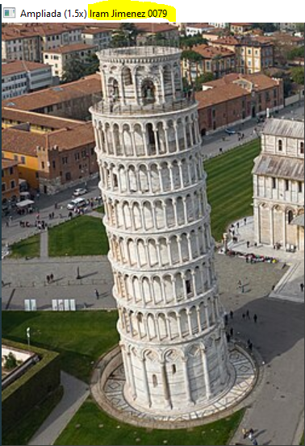
## 8. ROTACIÓN DE IMÁGENES
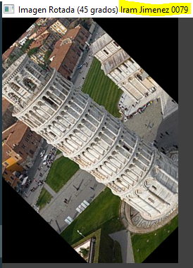
## 9. VOLTEO / ESPEJO DE IMÁGENES (FLIPPING)
#### Volteo horizontal
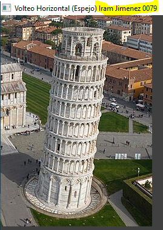
#### Volteo vertical
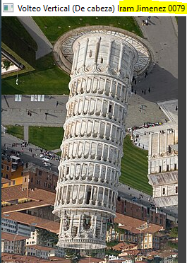
#### Volteo en Ambos Ejes
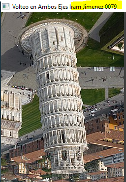
## 10. GUARDADO DE RESULTADOS Y LIMPIEZA
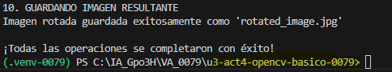